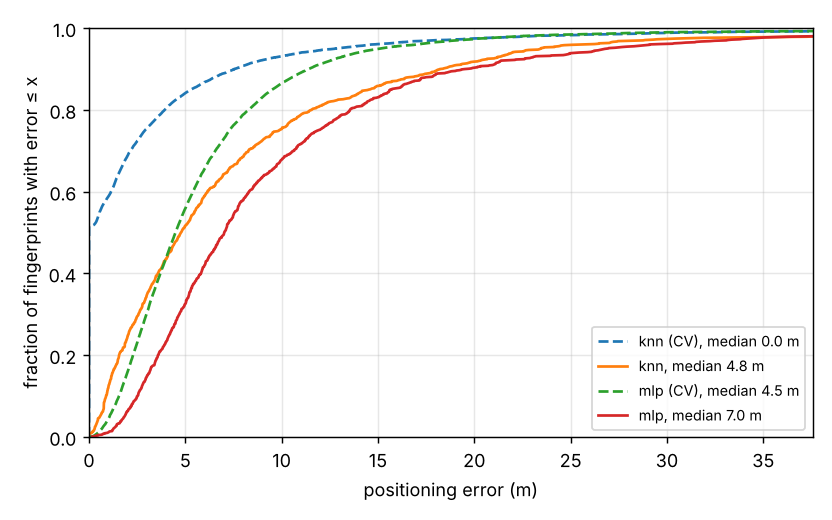
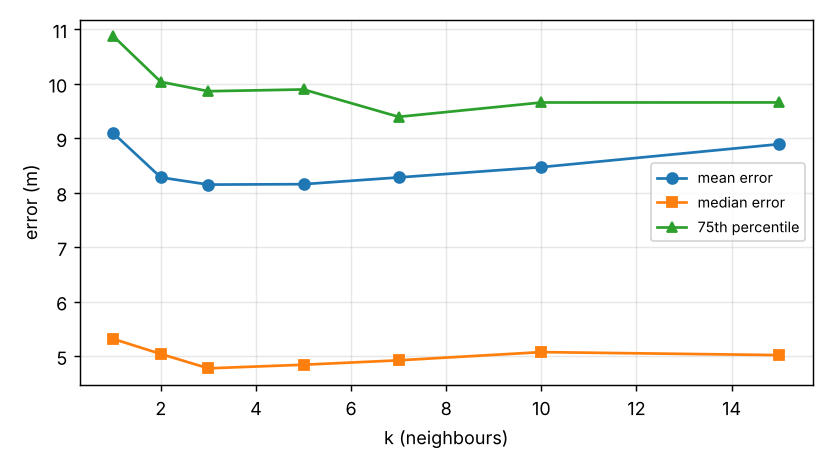
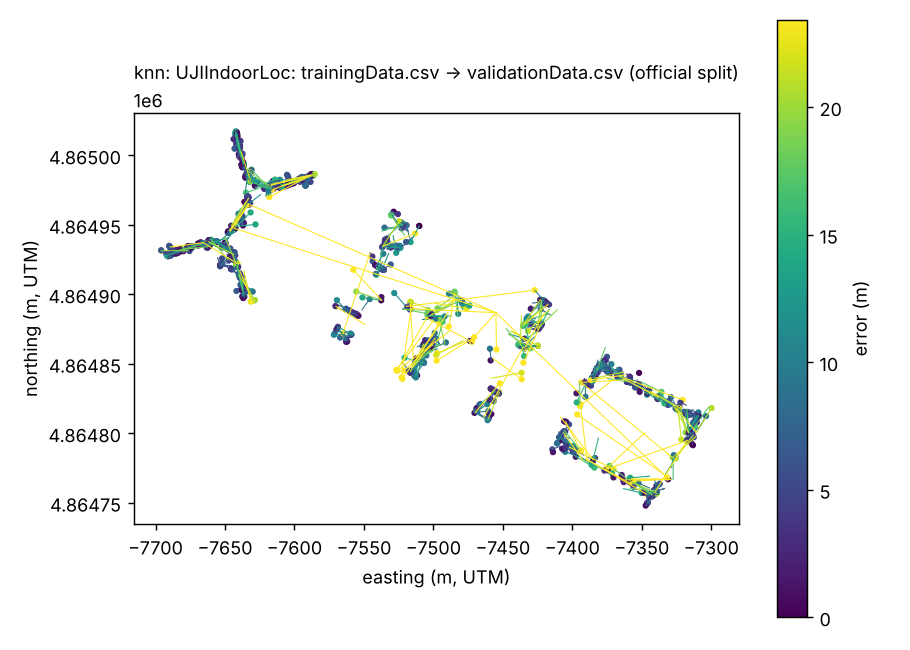
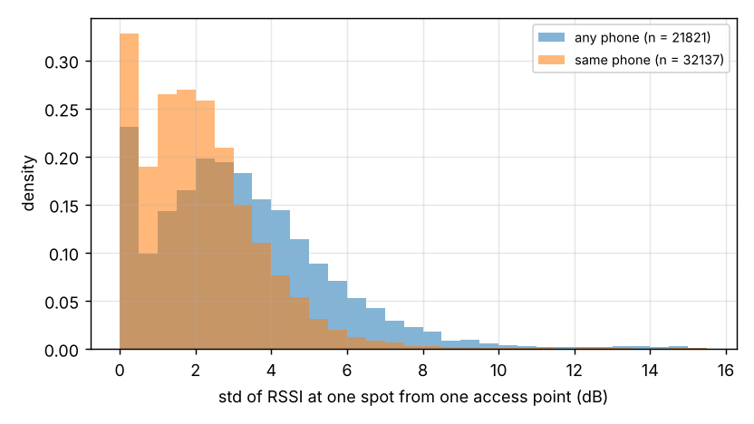

# wifi-rssi-localization

Indoor localisation by Wi-Fi fingerprinting on the public UJIIndoorLoc dataset: a phone records
the signal strength (RSSI) of every access point it can hear, and a model maps that vector to a
position, floor and building. This repo shows how far two standard methods, weighted k-nearest
neighbours and a small multilayer perceptron, get on the dataset's official train/validation
split, in metres, and why the error is what it is. Everything below is produced by `make all`.

```
UCI archive / mirrors ──download, SHA-256──▶ data/*.csv
                                                 │  520 RSSI values per fingerprint (100 = not seen)
                                                 ▼
                                   features.py: dBm → [0, 1]  ("positive" or "powed")
                                                 │
                     ┌───────────────────────────┴───────────────────────────┐
                     ▼                                                       ▼
        models.KnnLocalizer (k=3, Euclidean,                    models.MlpLocalizer (256-128,
        inverse-distance weighted mean + vote)                   regressor for x,y + classifier)
                     │                                                       │
                     └───────────────────────────┬───────────────────────────┘
                                                 ▼
          evaluate.py: error in metres, floor/building accuracy, 5-fold CV and official split
                                                 ▼
                    results/results.json  +  figures/01..04  (plots.py)
```

## Data

[UJIIndoorLoc](https://archive.ics.uci.edu/dataset/310/ujiindoorloc) (Torres-Sospedra et al.,
IPIN 2014, CC BY 4.0): three buildings of Universitat Jaume I, four to five floors each,
520 access points, positions in UTM metres.

| file | fingerprints | collected | people / phones | role |
|---|---|---|---|---|
| `trainingData.csv` | 19 937 at 905 reference points | 30 May – 20 Jun 2013 | 18 users, 16 phone ids | fit |
| `validationData.csv` | 1 111 at free positions | 19 Sep – 8 Oct 2013 | anonymous, 11 phone ids (9 unseen in training) | test |

`make data` downloads the two CSVs and checks their SHA-256. It tries the UCI archive first and
falls back to two public GitHub copies. The hashes in `data.py` come from three independent
copies that are byte-identical and have UCI's documented row counts; the UCI archive itself was
unreachable from the machine this repo was built on, so the first `make data` on a machine that
can reach it also confirms the archive matches (a mismatch is logged and the copy is discarded).
`data/` is git-ignored (45 MB).

## Run it

```bash
pip install -r requirements.txt
make check      # ruff + 14 pytest tests (synthetic building, no download)
make smoke      # whole pipeline on the synthetic building, ~20 s
make all        # = make data + make figures: real data, results.json, figures (4 min on 4 cores)
python -m rssi_loc run --k 5 --metric manhattan --features positive   # variants
```

## Results (official split: train on `trainingData.csv`, test on `validationData.csv`)

All numbers are from `results/results.json`, written by `make figures` on 2026-10-17.

| model | mean error | median | 75th pct | 95th pct | floor correct | building correct |
|---|---|---|---|---|---|---|
| kNN, k = 3, Euclidean, powed | 8.1 m | 4.8 m | 9.9 m | 23.4 m | 93.3 % | 99.6 % |
| MLP 256-128, powed | 9.7 m | 7.0 m | 11.9 m | 26.9 m | 93.7 % | 99.5 % |



Dashed lines are 5-fold cross-validation on the training set alone. Its kNN median is
0.0 m: the training set holds about 22 fingerprints per reference point, so a random
fold almost always contains a fingerprint from the exact spot being held out, and nearest
neighbour returns it. Random CV on fingerprint data measures memorisation. The official split
(different people, mostly different phones, four months later) is the number to quote.

**Choice of k, feature representation and distance** (kNN, official split):



| features | distance | mean | median | floor correct |
|---|---|---|---|---|
| positive | euclidean | 8.9 m | 5.5 m | 89.7 % |
| positive | manhattan | 11.0 m | 5.6 m | 88.7 % |
| powed | euclidean | 8.1 m | 4.8 m | 93.3 % |
| powed | manhattan | 10.0 m | 5.0 m | 91.1 % |

"Powed" raises the [0, 1] signal to the power e so strong access points dominate; it was proposed
for this dataset by the same authors in 2015. Euclidean beat Manhattan here on every metric, and
k between 3 and 5 is the flat part of the sweep. These are small differences on 1 111 test
fingerprints; the choice of split matters far more than any of them.

**Where the errors are.** The map joins each true test position to its prediction:



Most predictions land within a room or two; the long lines are fingerprints placed in the wrong
wing or, in the worst cases, the wrong building (4 of 1 111 for kNN).

## Why RSSI is noisy



For every (reference point, access point) pair seen at least five times in the training set, the
figure shows the standard deviation of the RSSI. The median is 3.0 dB across all phones and
1.9 dB when only one phone is at that spot; one in ten pairs varies by more than
6.3 dB. Over a log-distance path-loss model with exponent 3, 3.0 dB is a factor of
1.3 in distance, which is roughly the median error above. The causes, in the order
they usually matter indoors:

- **Multipath fading.** Reflections add with different phases; moving the phone a few
  centimetres changes the sum by several dB.
- **People and orientation.** A body between phone and access point absorbs 2.4 GHz well
  (several dB); the user's hand and the phone's orientation change the antenna pattern.
- **Device differences.** Chipsets report RSSI on their own scales and with their own antenna
  gains, which is why the same-phone spread is smaller and why nine unseen phones in the test set
  cost accuracy.
- **Time.** Access points are replaced, moved and re-tuned, doors open and close, furniture
  moves; a fingerprint map ages.
- **Quantisation and averaging.** Phones report integer dBm, often already smoothed by the driver.

Fingerprinting works despite this because the *pattern* over ~18 visible access points is more
stable than any one value, and because it never converts RSSI to distance; it only compares
vectors.

**How BLE and UWB compare.** Typical published figures, not measured in this repo:

| technology | what is measured | typical indoor error | cost of deployment |
|---|---|---|---|
| Wi-Fi RSSI fingerprinting (this repo) | signal strength of existing APs | 3–10 m, floor usually right | a site survey, no hardware |
| BLE beacons (RSSI) | signal strength of battery beacons placed on purpose | 1–3 m with a beacon every few metres | cheap beacons, dense placement, batteries |
| Wi-Fi RTT (802.11mc/az) | round-trip time to supporting APs | 1–2 m | APs and phones that support FTM |
| UWB (two-way ranging or TDoA) | time of flight at ~500 MHz bandwidth | 0.1–0.5 m line of sight | wired/synchronised anchors, UWB tags |

BLE has the same physics as Wi-Fi RSSI, so the same noise; it gains by letting you control
beacon density and placement. UWB is in a different class because it measures time, not power:
a 2 ns timing error is 0.6 m, and multipath mostly delays rather than attenuates the first path.
The price is infrastructure. For a farm building, an incubator room or a warehouse, the
engineering question is whether a few metres is good enough (which room, which aisle), in which
case the Wi-Fi that is already there, plus the fingerprinting in this repo, is the cheapest answer.

## Limitations

- One dataset, one campus, 2013 phones. Numbers transfer as orders of magnitude, not values.
- The validation set has 1 111 fingerprints; differences below about 0.5 m between variants are
  not meaningful.
- No hyper-parameter search on the test set beyond the k sweep and the four variants shown; the
  MLP architecture is a reasonable default, not a tuned one. Published results on this split
  range from about 8 m for tuned kNN to lower with per-building models and ensembles.
- Floor is predicted by vote or by a classifier, not by a hierarchy (building, then floor, then
  position); the hierarchical approach is the usual next step and is left as an extension.
- Nothing runs on a phone here: the fingerprints are evaluated offline.

## Next steps

1. Hierarchical model: classify building, then floor, then regress position with a per-floor kNN.
2. Per-phone calibration: fit a per-device RSSI offset from a handful of fingerprints and see how
   much of the unseen-phone penalty it removes.
3. Collect a fingerprint map of a real building with an ESP32 (its `WiFi.scanNetworks()` gives
   the same RSSI vector) and run the same code on it.

## Layout

```
src/rssi_loc/   data.py features.py models.py evaluate.py plots.py synthetic.py cli.py
tests/          14 tests on a synthetic building; test_cli runs the whole pipeline
results/        results.json (real), results/smoke (synthetic)
figures/        01_error_cdf  02_k_sweep  03_knn_map  03_mlp_map  04_rssi_repeatability
```

License: MIT. Dataset: CC BY 4.0, cite Torres-Sospedra et al., "UJIIndoorLoc: A new
multi-building and multi-floor database for WLAN fingerprint-based indoor localization
problems", IPIN 2014.
